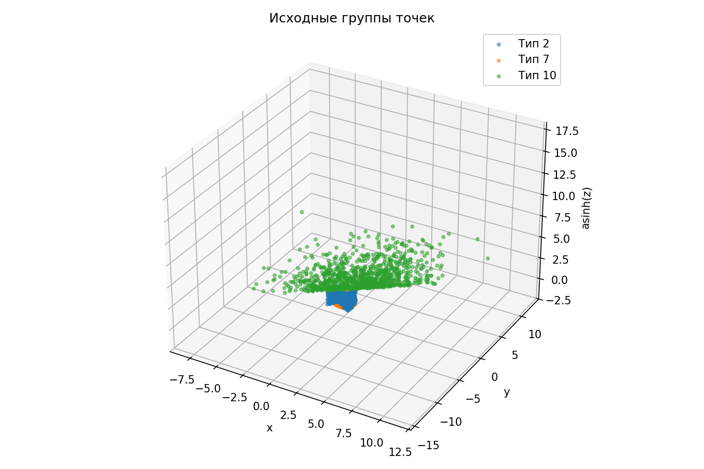
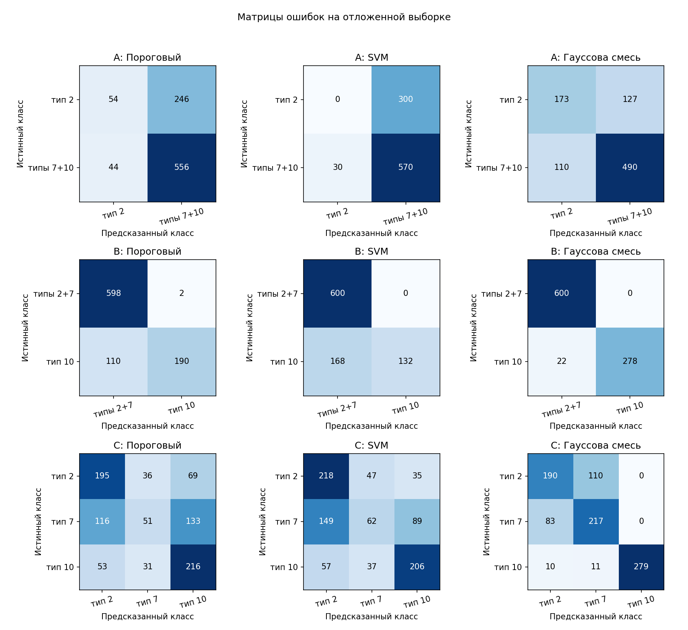

Отчет

По 1000 точек каждого типа. Train: 2100, test: 900.

На рисунке z сжата функцией asinh

## A: Тип 2 против типов 7+10

Метрики на отложенной выборке:

| Метод | Accuracy | Класс | Precision | Recall |
|---|---:|---|---:|---:|
| Пороговый | 0.6778 | тип 2 | 0.5510 | 0.1800 |
| Пороговый | 0.6778 | типы 7+10 | 0.6933 | 0.9267 |
| SVM | 0.6333 | тип 2 | 0.0000 | 0.0000 |
| SVM | 0.6333 | типы 7+10 | 0.6552 | 0.9500 |
| Гауссова смесь | 0.7367 | тип 2 | 0.6113 | 0.5767 |
| Гауссова смесь | 0.7367 | типы 7+10 | 0.7942 | 0.8167 |

## B: Типы 2+7 против типа 10

Метрики на отложенной выборке:

| Метод | Accuracy | Класс | Precision | Recall |
|---|---:|---|---:|---:|
| Пороговый | 0.8756 | типы 2+7 | 0.8446 | 0.9967 |
| Пороговый | 0.8756 | тип 10 | 0.9896 | 0.6333 |
| SVM | 0.8133 | типы 2+7 | 0.7812 | 1.0000 |
| SVM | 0.8133 | тип 10 | 1.0000 | 0.4400 |
| Гауссова смесь | 0.9756 | типы 2+7 | 0.9646 | 1.0000 |
| Гауссова смесь | 0.9756 | тип 10 | 1.0000 | 0.9267 |

## C: Три отдельных класса

Метрики на отложенной выборке:

| Метод | Accuracy | Класс | Precision | Recall |
|---|---:|---|---:|---:|
| Пороговый | 0.5133 | тип 2 | 0.5357 | 0.6500 |
| Пороговый | 0.5133 | тип 7 | 0.4322 | 0.1700 |
| Пороговый | 0.5133 | тип 10 | 0.5167 | 0.7200 |
| SVM | 0.5400 | тип 2 | 0.5142 | 0.7267 |
| SVM | 0.5400 | тип 7 | 0.4247 | 0.2067 |
| SVM | 0.5400 | тип 10 | 0.6242 | 0.6867 |
| Гауссова смесь | 0.7622 | тип 2 | 0.6714 | 0.6333 |
| Гауссова смесь | 0.7622 | тип 7 | 0.6420 | 0.7233 |
| Гауссова смесь | 0.7622 | тип 10 | 1.0000 | 0.9300 |

## Новая выборка: тип 2 против типов 7+10

| Метод | Старая полная | Старый test | Новая | Новая минус test, п.п. |
|---|---:|---:|---:|---:|
| Пороговый | 0.6673 | 0.6778 | 0.6557 | -2.21 |
| SVM | 0.6280 | 0.6333 | 0.6260 | -0.73 |
| Гауссова смесь | 0.7390 | 0.7367 | 0.7190 | -1.77 |

Старая полная выборка содержит обучающие точки. Для независимого сравнения используем test и новую выборку.

